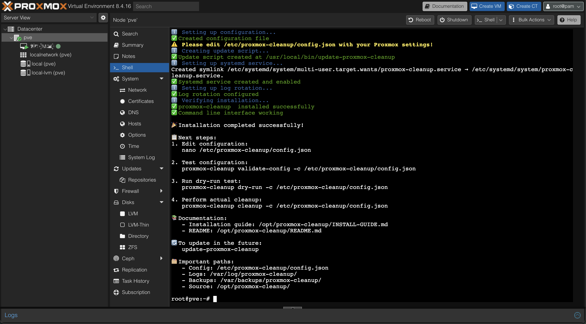
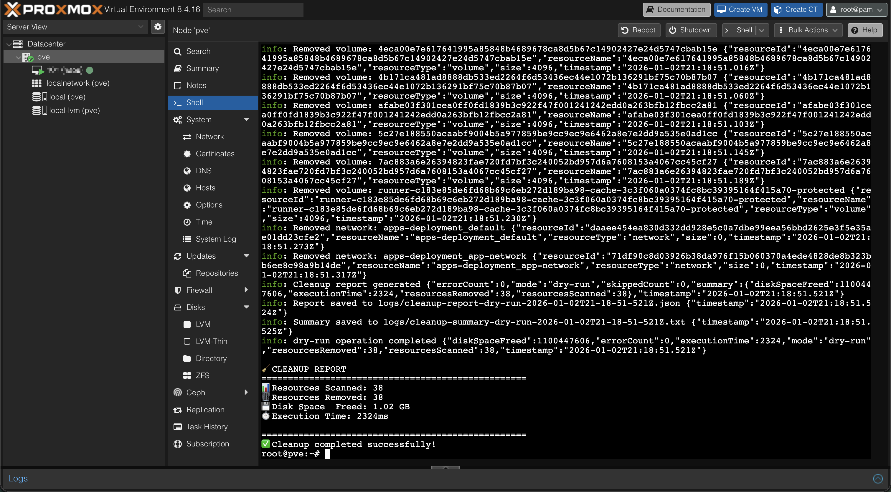

# Proxmox Cleanup - Docker cleanup CLI for Proxmox hosts

<div align="center">

<!-- Status Badges -->
   

<!-- Community Badges -->
   

<!-- Support -->
[](https://buymeacoffee.com/hiallfyi)

**Proxmox Cleanup finds the Docker containers, images, volumes and networks nothing is using on your Proxmox host, shows you what it would remove, and only then removes them.**

[Quick Start](#quick-start) • [Features](#features) • [Configuration](#configuration) • [CLI Reference](#cli-reference) • [FAQ](#faq-and-troubleshooting)

</div>

---

## About

Proxmox Cleanup is a Node.js command-line tool for hosts that run Docker directly on a Proxmox VE node. It talks to the local Docker daemon, works out which resources are unused, and removes them. It is developed independently of Proxmox and Docker.

Cleanup itself only talks to Docker. Proxmox is contacted by one command, `validate-config`, which checks that your Proxmox host and credentials work.

---

## Why use Proxmox Cleanup

Three situations where it's worth a look:

1. **Disk space keeps shrinking and you're not sure why.** Stopped containers, old images and orphaned volumes pile up on a host that runs Docker for a while. `proxmox-cleanup list` shows what's unused, grouped by type and sorted largest first.
2. **You want to see the result before anything is deleted.** `dry-run` runs the whole pipeline and removes nothing. The report and the log both say "would remove", so a preview can't be mistaken for a real run.
3. **You want it to run on a schedule without surprises.** Protection patterns keep named things safe, `--older-than` leaves recent resources alone, and the exit code tells cron or systemd whether anything failed.

If you only clean up now and then, `docker system prune` does a similar job. This tool adds the dry-run report, protection patterns by name, label or ID, and a metadata manifest written before each cleanup.

---

## Quick start



### Prerequisites

- Node.js 18+
- Docker daemon running
- npm, to build from source
- A Proxmox VE host with its API reachable on port 8006, only if you want `validate-config` to test the Proxmox connection

### 1. Install

```bash
curl -fsSL https://raw.githubusercontent.com/hiall-fyi/proxmox-cleanup/main/scripts/install.sh | bash
```

The installer must run as root. It checks for Node.js (installing it with `apt` if missing), Git and a running Docker daemon, then clones the repository to `/opt/proxmox-cleanup`, builds it, and installs the `proxmox-cleanup` command globally. It also:

- copies `config.example.json` to `/etc/proxmox-cleanup/config.json` (mode 600, with the backup and log paths set to `/var/backups/proxmox-cleanup` and `/var/log/proxmox-cleanup`), unless that file already exists
- creates and enables a systemd unit, `proxmox-cleanup.service`
- sets up daily log rotation for `*.log` files in the log directory, keeping 30
- adds an `update-proxmox-cleanup` command that pulls, rebuilds and reinstalls

Re-running the installer over an existing install resets local changes in `/opt/proxmox-cleanup` and leaves your config file alone (it saves a timestamped copy next to it first).

<details>
<summary>Install from source</summary>

```bash
git clone https://github.com/hiall-fyi/proxmox-cleanup.git
cd proxmox-cleanup
npm install
npm run build
npm install -g .          # optional: puts `proxmox-cleanup` on your PATH
```

Without the last line, run it as `node dist/cli/index.js` from the clone. The source install doesn't create a config file, systemd unit or log rotation, so copy `config.example.json` yourself.

</details>

### 2. Configure

```bash
nano /etc/proxmox-cleanup/config.json
```

See [Configuration](#configuration) for every key. The most useful ones to review first are `protectedPatterns` and `resourceTypes`.

### 3. Validate

```bash
proxmox-cleanup validate-config -c /etc/proxmox-cleanup/config.json
```

This checks the file's structure, tests the Proxmox connection (only if both `host` and `token` are set) and tests the Docker connection.

### 4. Dry run

```bash
proxmox-cleanup dry-run -c /etc/proxmox-cleanup/config.json
```



*A dry-run on Proxmox VE 8.4.16: 38 resources scanned, 1.02 GB would be freed, in 2.3 seconds. Taken on an earlier version, so some wording has since changed.*

### 5. Clean up

```bash
proxmox-cleanup cleanup -c /etc/proxmox-cleanup/config.json
```

With `resourceTypes` empty (the default), this removes unused containers, images, volumes and networks. Removing a volume deletes its data, and the backup manifest can't bring it back (see [Backup manifest](#backup-manifest)). Run the dry run first, and protect anything you care about.

### 6. Schedule it

See [Scheduling](#scheduling).

---

## Features

### What counts as unused

| Type | Removed when |
| --- | --- |
| containers | Exited, created but never started, or dead |
| images | Not used by any container, running or stopped |
| volumes | Not mounted by any container, running or stopped |
| networks | No container attached, and not one of Docker's built-ins (`bridge`, `host`, `none`) |

A running, paused, restarting or mid-removal container is never removed. A paused container is a live workload, so it's left alone and reported as skipped with the reason. A container state the tool doesn't recognise is treated the same way: not removable.

Volume mounts are read from named volumes only; bind mounts are ignored.

### Safety checks

- **Fresh in-use check.** Just before removing, the tool re-reads the container list and checks every candidate against it, so a resource that a container started using after the scan is skipped, not removed.
- **Container removal isn't forced.** If the Docker daemon says a container is running, the removal fails and is reported as an error.
- **Protection patterns.** Names, wildcards, labels and IDs. See [Protection patterns](#protection-patterns).
- **Age filter.** `--older-than` removes only resources created at least that long ago.
- **Backup manifest.** See below.
- **Dry run.** `dry-run` (or `--dry-run` on `cleanup`) scans and reports without removing anything, and writes no backup manifest.

### Backup manifest

Before a cleanup removes anything, it writes the candidates' metadata (names, IDs, sizes, dependencies) to a JSON file named `cleanup_<timestamp>_<number>.backup.json` in `backupPath`. If the manifest can't be written, the cleanup stops before removing anything.

It's a record for manual recovery, not a restore point. Metadata can't bring back a volume's contents or an image's layers, and there's no `restore` command.

### Reports and logs

Every `cleanup` and `dry-run` run that completes writes two files to `logPath`: `cleanup-report-<mode>-<timestamp>.json` and `cleanup-summary-<mode>-<timestamp>.txt`. The summary lists what was removed, what was skipped and why, and anything that failed. Structured logs go to `cleanup.log` and `cleanup-error.log` in the same directory, each rotating at 10 MB with five files kept.

`list` doesn't write a report.

### Machine-readable output

`--json` on any command prints JSON only and suppresses the human-readable output. If a command can't run, it prints `{"error": {"message": "..."}}` and exits with code 1.

---

## Configuration

Create a `config.json` (start from `config.example.json`) and pass it with `-c`:

```json
{
  "proxmox": {
    "host": "proxmox.example.com",
    "token": "root@pam:your-api-token-here",
    "verifyTls": false
  },
  "cleanup": {
    "dryRun": false,
    "resourceTypes": [],
    "protectedPatterns": ["important-*", "system-*", "production-*"],
    "backupEnabled": true,
    "backupPath": "./backups",
    "minAge": "7d",
    "keepBackups": 30
  },
  "reporting": {
    "verbose": true,
    "logPath": "./logs",
    "keepReports": 30
  }
}
```

The three sections (`proxmox`, `cleanup`, `reporting`) must all be present. `minAge` isn't in `config.example.json`; add it if you want it. Without `-c`, the tool uses built-in defaults: no protection patterns, backups on, `./backups` and `./logs`. Relative paths resolve from the directory you run the command in.

| Key | Purpose | CLI flag |
| --- | --- | --- |
| `proxmox.host` | Proxmox host name. Used by `validate-config`, and recorded in the backup manifest. | `--proxmox-host` |
| `proxmox.token` | Credentials, used by `validate-config` only. See [Proxmox credentials](#proxmox-credentials). | `--proxmox-token` |
| `proxmox.verifyTls` | `true` checks Proxmox's TLS certificate. Off by default. | none |
| `cleanup.dryRun` | Preview only. | `-d, --dry-run` (can turn it on, not off) |
| `cleanup.resourceTypes` | Types to clean. Empty means all four. | `-t, --types` |
| `cleanup.protectedPatterns` | Resources to keep. | `-p, --protect` (adds to the list) |
| `cleanup.backupEnabled` | Write a backup manifest before removing. | `-b, --backup` / `--no-backup` |
| `cleanup.backupPath` | Where manifests go. | `--backup-path` |
| `cleanup.minAge` | Only touch resources at least this old. | `--older-than` |
| `cleanup.keepBackups` | Manifests to keep. | none |
| `reporting.verbose` | Log at debug level, including every resource your protection patterns kept out. | `-v, --verbose` |
| `reporting.logPath` | Where logs and reports go. | `--log-path` |
| `reporting.keepReports` | Report and summary pairs to keep. | none |

A flag only takes effect when you pass it; omit it and the config file wins. `-p` is the exception to "wins": it adds to the config file's patterns instead of replacing them.

**File retention.** `keepBackups` and `keepReports` (30 each by default) cap how many manifests and report files are kept. After each write, the oldest files beyond the limit are deleted, ordered by modification time. Reports and summaries are counted per mode, so a run of `dry-run` can't push out the record of a real cleanup.

**Age filtering.** `minAge` (or `--older-than`) takes a whole number and a unit: `s`, `m`, `h`, `d` or `w`, for example `7d` or `12h`. A resource is kept as a candidate when it was created at least that long ago. Age is time since creation, not since last use. An invalid value stops the run before it touches Docker.

When Docker reports no creation time for a resource (volumes often don't), `--older-than` skips it. `cleanup`, `dry-run` and `list` each show a separate count of these.

### Protection patterns

Patterns come from `protectedPatterns` and from `-p`/`--protect` (comma-separated). A resource matching any pattern is left alone.

- **Wildcards:** `important-*`, `*-production`, `*-system-*`. Matched against the whole name, and `*` is the only wildcard.
- **Exact names:** `my-important-container`
- **Labels:** `tag:backup` matches any resource carrying that label. `tag:env=production` matches key and value.
- **IDs:** `id:ec3f0931a6e6` (the short ID that `docker images` and `docker ps` print) or the full `sha256:...` digest. IDs shorter than 12 characters are rejected as ambiguous.

`-p` adds to what your config already protects. A config guarding `production-*` stays protected even if you also pass `-p "test-*"` for a one-off run.

**Untagged ("dangling") images.** They show as `<none>:<none>` plus a short ID, so a name pattern like `important-*` never matches one. To keep a specific one, protect it by ID, by label, or with a wildcard on its short ID (`*ec3f0931a6e6*`).

**Typos stop the run.** Prefixes are lower-case and exact (`tag:`, `id:`). If a pattern can't match anything (a misspelt prefix such as `tags:`, `label:` or `name:`, an ID that's too short, or a prefix with nothing after it), the command stops and names the pattern instead of running with a protection list that does nothing.

### Proxmox credentials

The `token` field takes either form Proxmox issues: the API token `user@realm!tokenid:secret` (recommended), or the legacy `user@realm:password`. Only `validate-config` uses it. API-token credentials are checked against `/version`, and user and password against `/access/ticket`, and those are the only two Proxmox calls the tool makes.

Avoid `--proxmox-token`: it leaves the token in your shell history and visible to other users through `ps`. Set the `PROXMOX_TOKEN` environment variable instead, or keep it in `config.json`. The variable is used only when neither the flag nor the config file gives a token.

**TLS.** Certificate verification is off by default, because Proxmox ships a self-signed certificate. If you've installed one from a real CA, set `"verifyTls": true` under `proxmox`. `validate-config` prints a warning when it isn't `true` (not in `--json` mode).

### Scheduling

The installer enables `proxmox-cleanup.service`, a one-shot unit that runs `cleanup` with `/etc/proxmox-cleanup/config.json`. Because it's enabled, it also runs at boot. Run it on a schedule with a systemd timer:

```ini
# /etc/systemd/system/proxmox-cleanup.timer
[Unit]
Description=Run Proxmox Cleanup daily

[Timer]
OnCalendar=*-*-* 02:00:00
Persistent=true

[Install]
WantedBy=timers.target
```

```bash
systemctl enable --now proxmox-cleanup.timer
```

Or use cron, with the full path from `which proxmox-cleanup`:

| Pattern | Schedule |
| --- | --- |
| `0 2 * * *` | Daily at 2 AM |
| `0 */6 * * *` | Every 6 hours |
| `0 0 * * 0` | Weekly on Sunday |
| `0 0 1 * *` | Monthly on the 1st |

Run `dry-run` for a while before you schedule a real `cleanup`.

---

## CLI reference

`proxmox-cleanup --version` prints the version, and `--help` works on every command. Resource types are `containers`, `images`, `volumes`, `networks` or `all` (singular forms work too), comma-separated.

### `cleanup`

Remove unused Docker resources.

```text
proxmox-cleanup cleanup [options]

  -d, --dry-run              Preview without removing
  -t, --types <types>        Resource types, or all (default: all)
  -p, --protect <patterns>   Protection patterns (wildcards supported)
  -b, --backup               Create a backup manifest (default: on)
  --no-backup                Disable the backup manifest
  --backup-path <path>       Backup directory (default: ./backups)
  -c, --config <path>        Configuration file
  -v, --verbose              Enable verbose logging
  --log-path <path>          Log directory (default: ./logs)
  --proxmox-host <host>      Proxmox host address
  --proxmox-token <token>    Proxmox credentials (see above)
  --older-than <duration>    Only act on resources created at least this long ago (e.g. 7d, 12h)
  --json                     JSON output only
```

### `dry-run`

Preview what `cleanup` would remove, without changing anything. Takes the same options as `cleanup` except `-d`, `-b`, `--no-backup` and `--backup-path`.

### `list`

List unused resources without removing anything, grouped by type and sorted largest first.

```text
proxmox-cleanup list [options]

  -t, --types <types>        Resource types to list, or all
  -p, --protect <patterns>   Protection patterns
  -c, --config <path>        Configuration file
  --older-than <duration>    Only list resources created at least this long ago
  --json                     JSON output only
```

`list` uses the same selection as `cleanup`, so its output matches what `cleanup` would act on.

### `validate-config`

Check the configuration file and test the connections.

```text
proxmox-cleanup validate-config [options]

  -c, --config <path>        Configuration file (default: ./config.json)
  --json                     JSON output only
```

It checks structure and resource types in the file, then Proxmox (only when `host` and `token` are both set), then Docker. With `--json` it prints `{"valid": true, "checks": {...}}`.

### Exit codes

| Code | Meaning |
| --- | --- |
| 0 | The command did what it set out to do. Skipped resources (protected, in use, or without a creation time) count as success. |
| 1 | The command couldn't run (Docker unreachable, bad config, invalid `--older-than`), or, for `cleanup` only, at least one resource failed to remove. Failures are itemised in the report. |

If you pass `-c` with a path that doesn't exist, the command fails instead of falling back to defaults. Otherwise a typo would run with none of your protection patterns.

### Examples

```bash
# Preview what would be removed
proxmox-cleanup dry-run

# Preview only containers and images
proxmox-cleanup dry-run --types containers,images

# Clean everything unused, with a backup manifest
proxmox-cleanup cleanup

# Clean only volumes, no manifest
proxmox-cleanup cleanup --types volumes --no-backup

# Only touch resources created at least 7 days ago
proxmox-cleanup cleanup --older-than 7d

# Keep a few extra names for this run, on top of the config file
proxmox-cleanup cleanup -p "test-*,tag:keep"

# JSON for scripting
proxmox-cleanup list --json > unused-resources.json
```

---

## Known limitations

| Limitation | Detail |
| --- | --- |
| Volume and network sizes are unknown | The Docker Engine reports neither, so they show as "size unknown" rather than `0 B`. "Disk Space Freed" is a minimum whenever a volume or network was removed, and the report says so. |
| The backup manifest isn't a restore point | It records metadata only. A removed volume's data is gone. |
| Images and volumes used only by stopped containers need a second run | Stopped containers count as users, so a first `cleanup` removes the container and leaves its image, volumes and networks. They become unused for the next run. |
| Image removal is forced | An unused image goes with all of its tags. |
| Age is creation time | Not last use. Resources with no creation time are skipped when `--older-than` is set. |
| TLS verification is off by default | It only affects the `validate-config` Proxmox check. |
| The Docker socket | The tool uses the default socket, `/var/run/docker.sock`. There's no config option or flag for another path. |
| Proxmox versions | Proxmox is only contacted by `validate-config`. The only version this was checked against is the Proxmox VE 8.4.16 host in the screenshot above. |

---

## FAQ and troubleshooting

<details>
<summary><strong>Why wasn't a resource removed?</strong></summary>

Resources that are still in use, or that match a protection pattern, never reach the report at all. Paused and restarting containers appear in its skipped list with a reason. With `--older-than`, a resource that's too new is left out without a trace, while one with no creation time is counted separately as skipped.

To see which resources your protection patterns kept out, run with `-v` (or set `reporting.verbose` to `true`). Each one gets a `Protected <type>: <name>` line in the log, followed by two counts: how many unused resources were left after protection, and how many candidates were left after the type and age filters. Debug lines go to `cleanup.log` and, unless you use `--json`, to the console.

</details>

<details>
<summary><strong>The command stopped and complained about a protection pattern.</strong></summary>

The pattern can't match anything, usually because of a misspelt prefix (`tags:` instead of `tag:`) or an ID shorter than 12 characters. Fix or remove it and run again.

</details>

<details>
<summary><strong>Docker daemon not running</strong></summary>

```bash
systemctl status docker
systemctl start docker
```

</details>

<details>
<summary><strong>Permission denied errors</strong></summary>

```bash
sudo usermod -aG docker $USER
newgrp docker
```

</details>

<details>
<summary><strong>Configuration validation failed</strong></summary>

```bash
proxmox-cleanup validate-config -c /etc/proxmox-cleanup/config.json
tail -f /var/log/proxmox-cleanup/cleanup.log
```

The second path is where the installer's config sends logs. If you use another `logPath`, look there.

</details>

<details>
<summary><strong>Something was removed that I wanted to keep.</strong></summary>

The report in your log directory lists exactly what went, and the backup manifest in your backup directory records its metadata. Add a protection pattern for it, and attach both files if you open an issue.

</details>

For anything else, check `cleanup.log` and `cleanup-error.log` in your log directory, search the existing [issues](https://github.com/hiall-fyi/proxmox-cleanup/issues), and if it's new, [open one](https://github.com/hiall-fyi/proxmox-cleanup/issues/new/choose). For usage questions, [Discussions](https://github.com/hiall-fyi/proxmox-cleanup/discussions) is the better place.

---

## Uninstall

For an install made by the script:

```bash
systemctl disable --now proxmox-cleanup.service
rm /etc/systemd/system/proxmox-cleanup.service /etc/logrotate.d/proxmox-cleanup /usr/local/bin/update-proxmox-cleanup
systemctl daemon-reload
npm uninstall -g proxmox-cleanup
rm -rf /opt/proxmox-cleanup
```

Your config in `/etc/proxmox-cleanup`, logs in `/var/log/proxmox-cleanup` and manifests in `/var/backups/proxmox-cleanup` stay until you delete them.

---

## Development

```text
src/
  types/          Type definitions
  interfaces/     Interface contracts
  clients/        Docker and Proxmox clients
  scanners/       Finding unused resources
  utils/          Protection filter, age filter, sizes, retention
  managers/       Backup manifests
  reporters/      Reports and logs
  orchestrators/  Workflow coordination
  cli/            Command-line interface
```

```bash
npm test               # run the test suite
npm run test:coverage  # with coverage
npm run build          # compile to dist/
npm run lint           # eslint
npm run smoke          # pack the tarball, install it, and run the commands
```

The tests include property-based tests with `fast-check` covering resource identification, safe removal, backup contents, size calculation and report consistency, alongside unit tests for the clients, scanner, orchestrator, reporter and backup manager.

---

## Documentation

| Document | Purpose |
| --- | --- |
| [CHANGELOG.md](CHANGELOG.md) | Version history |
| [config.example.json](config.example.json) | Example configuration |
| [LICENSE](LICENSE) | MIT licence text |

### External resources

- [Docker documentation](https://docs.docker.com/)
- [Proxmox VE documentation](https://pve.proxmox.com/wiki/Main_Page)
- [fast-check](https://github.com/dubzzz/fast-check)

---

## Contributing

Bug reports and feature requests are welcome through the [issue forms](https://github.com/hiall-fyi/proxmox-cleanup/issues/new/choose); logs and the report file make the biggest difference. For questions or ideas, use [Discussions](https://github.com/hiall-fyi/proxmox-cleanup/discussions).

For code: fork the repository, create a branch, commit, push, and open a pull request.

---

## License

Released under the **MIT License**. See [LICENSE](LICENSE) for the full text.

**Author:** Joe Yiu ([@hiall-fyi](https://github.com/hiall-fyi))

---

<details>
<summary><strong>Disclaimer</strong></summary>

This project is not affiliated with, endorsed by, or connected to Proxmox Server Solutions GmbH or Docker, Inc. Proxmox and the Proxmox logo are registered trademarks of Proxmox Server Solutions GmbH. Docker and the Docker logo are registered trademarks of Docker, Inc. All product names, logos and brands are property of their respective owners.

This tool is provided "as is" without warranty of any kind. Use at your own risk.

</details>
